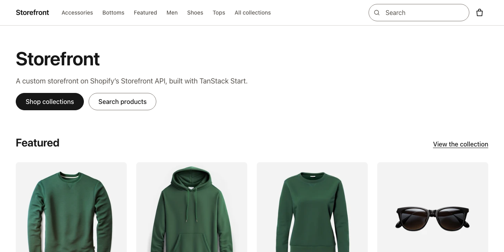

# TanStack Start storefront for Shopify

A complete custom storefront on Shopify's Storefront API, built with TanStack Start and ready to deploy on Netlify. It has collections with sorting, filtering and pagination, product pages where every variant has its own URL, search with suggestions, a cart drawer and cart page with optimistic updates, a sitemap, structured data and CDN caching. Clone it, run two commands and you have a working shop, with no Shopify account and no env file.

**Live demo:** [starter.unccub.com](https://starter.unccub.com)



## Quick start

You need Node 22.12 or newer.

```bash
git clone https://github.com/unccub/tanstack-start-shopify-storefront.git
cd tanstack-start-shopify-storefront
npm install && npm run dev
```

Open <http://localhost:3000>. With no env file the storefront talks to [mock.shop](https://mock.shop), Shopify's free mock Storefront API.

What works on mock.shop:

- Products, collections, sorting, pagination, search and search suggestions.
- The cart: add, change quantity, remove. It survives a reload.

What mock.shop cannot show you:

- **Checkout.** The checkout link goes to a mock page that does not receive your cart.
- **Customer accounts.** They are not available, and this starter does not include them.
- **Filters.** mock.shop returns none, so the filter form stays hidden.
- **Discount codes.** The form works, but mock.shop rejects every code.
- **Sale prices and markets.** No product has a compare-at price, and the country setting has no effect.

## Connect your own store

The full walkthrough is in [docs/moving-to-a-real-store.md](docs/moving-to-a-real-store.md). In short:

### Without a token

Copy `.env.example` to `.env` and set your store's domain:

```bash
PUBLIC_STORE_DOMAIN=your-store.myshopify.com
```

Shopify's tokenless access covers products, collections, search, pages and the cart. Two things to know:

- Each query may cost at most 1,000 complexity points. Every query in this starter fits; the cart is the largest at about 517, which is why a cart shows at most 50 distinct lines. Set `STOREFRONT_LOG_COST=1` to log each query's cost on the server.
- Shopify does not serve menus without a token, so the header and footer navigation is built from your collections.

### With a private token

```bash
PRIVATE_STOREFRONT_API_TOKEN=your-private-token
```

With a token the navigation comes from your store's `main-menu` and `footer` menus. Links to routes this storefront has (collections, products, pages, search, cart) are kept; anything else is left out.

The token stays on the server. It is read in one place, `src/shopify/env.server.ts`. Only `src/shopify/client.server.ts` sends it anywhere (`content.server.ts` just checks whether one is set, to choose between menus and collections), as `Shopify-Storefront-Private-Token` together with the shopper's IP in `Shopify-Storefront-Buyer-IP`. Every Storefront API call runs in a server function or a server route, and the variable has no `PUBLIC_` prefix, so the bundler never exposes it. To check, build and search the client bundle:

```bash
npm run build && grep -r "PRIVATE_STOREFRONT" dist/client || echo "not in the client bundle"
```

### Settings

`storefront.config.ts` holds the API version, country, language, shop name and the handle of the collection featured on the home page. The env variables are:

| Variable | Purpose |
| --- | --- |
| `PUBLIC_STORE_DOMAIN` | Your store's domain. Empty means mock.shop. |
| `PRIVATE_STOREFRONT_API_TOKEN` | Optional private Storefront API token. Server only. |
| `PUBLIC_NOINDEX` | `true` adds `noindex` to every page and makes `robots.txt` disallow everything. For demo and staging deployments. |
| `PUBLIC_SITE_URL` | Optional. The site's public address, for canonical URLs and the sitemap. On Netlify the site's own URL is used when this is empty. |
| `STOREFRONT_LOG_COST` | Optional. Logs each query's cost on the server. |

The `PUBLIC_` values are fixed when the site is built, so rebuild after changing them.

## Deploy

[](https://app.netlify.com/start/deploy?repository=https://github.com/unccub/tanstack-start-shopify-storefront)

The button copies the repository to your account and deploys it against mock.shop. Add the env variables above in Netlify's site settings to point it at your store, then redeploy. `netlify.toml` already has the build command and publish folder.

## Scripts

| Script | What it does |
| --- | --- |
| `npm run dev` | Development server on port 3000. |
| `npm run build` | Production build. |
| `npm start` | Serves the production build on plain Node with compression, for local checks. Reads env variables from the shell only. |
| `npm run typecheck` | `tsc --noEmit`, strict mode. |
| `npm run codegen` | Downloads the Storefront API schema and regenerates the GraphQL types. |
| `npm run codegen:check` | Checks every GraphQL document against the schema. |
| `npm run test:e2e` | Playwright smoke test against mock.shop. Builds and starts the server itself. |
| `npm run lighthouse` | Builds, serves and runs Lighthouse (mobile) on the home page, a collection and a product. |
| `npm run social-preview` | Regenerates `.github/social-preview.png` from the home page. |

## Project map

```
storefront.config.ts      Store settings: API version, country, language, shop name, featured collection
src/
  config.ts               Values derived from the settings (API URL, site URL, locale)
  router.tsx              Router setup and plain-string search params
  server.ts               Server entry: cache rules and noindex header, applied last
  routes/                 One file per route, plus sitemap.xml and robots.txt
  shopify/                Every call to Shopify lives here
    client.server.ts      The one fetch wrapper: URL, token, buyer IP, errors
    *.server.ts           Queries and mutations
    *.functions.ts        Server functions the routes and components call
    fragments/            GraphQL fragments and their types
    sanitise.ts           Allowlist sanitiser for product and page HTML
    images.ts             Shopify CDN image URLs and srcset
  components/
    layout/               Header, footer, skip link, status pages
    catalogue/            Product card and grid, gallery, variant picker, sort and filter form
    cart/                 Drawer, lines, discount form, hooks, add to cart button
    search/               Header search and the suggestions combobox
  lib/                    SEO helpers, cache policies, money formatting, search-param validation
  styles/tokens.css       Every colour, space, radius and type size
docs/                     Caching, and moving to a real store
scripts/                  Production server, Lighthouse runner, social preview
tests/                    Playwright smoke test
```

## Design decisions

### Why there is no Hydrogen dependency yet

Shopify's framework-agnostic Hydrogen became generally available in October 2026. It has no TanStack Start binding yet, so this starter talks to the Storefront API directly, pinned to version 2026-10, through one small fetch wrapper. All Shopify access is in `src/shopify/`, and components only import its server functions and types. If I adopt Hydrogen's primitives later, the change stays inside that folder.

### Why CSS Modules and one tokens file

Plain CSS in CSS Modules needs no runtime and no build plugin beyond what Vite already does, and the whole stylesheet is about 5.5 kB compressed, small enough to inline in the HTML. Every colour, spacing step, radius and type size is a custom property in `src/styles/tokens.css`, and the modules use only those. A rebrand is that one file. The light and dark colour schemes follow the visitor's system setting. There is no UI kit, no utility framework, no animation library and no web font.

### How the cart works

- The cart id is kept in an `httpOnly`, `SameSite=Lax` cookie, so scripts in the page cannot read it.
- Server functions in `src/shopify/cart.functions.ts` create the cart, add, update and remove lines, and apply discount codes. Their responses are never cached.
- In the browser, TanStack Query holds the cart. Quantity changes and removals show at once, and roll back with a message if the server refuses. Changes run one after another, so quick clicks do not race. Adding a new product waits for the server before the line appears.
- If the cookie points at a cart Shopify no longer has, adding a product starts a new cart. Changing a line in a dead cart empties it and says so.
- The cart loads in the browser after the page has settled. It is never part of the server-rendered HTML, which is what lets catalogue pages be cached for everyone.
- Checkout is a link to the cart's `checkoutUrl`.

### Why gql.tada

GraphQL types are inferred by TypeScript from the committed `schema.graphql`, so there is no generated file per query and no watcher to run. `npm run codegen:check` validates every document in CI. The schema comes from Shopify's 2026-10 API, never from mock.shop, whose schema has extra fields a real store would reject.

### Caching

Catalogue pages are stored on Netlify's CDN for 60 seconds and then served stale for up to a day while a fresh copy is rendered; browsers always revalidate. The cart and search results are never stored. The reasoning, and what is unverified until deployed, is in [docs/caching.md](docs/caching.md).

## Performance and accessibility

Lighthouse, mobile emulation with default throttling, three consecutive runs on the production build, measured on my machine against mock.shop on 12 November 2026:

| Page | Performance | Accessibility | Best practices | SEO |
| --- | --- | --- | --- | --- |
| Home | 98 | 100 | 100 | 100 |
| Collection (`/collections/men`) | 99 to 100 | 100 | 100 | 100 |
| Product (`/products/men-crewneck`) | 98 to 99 | 100 | 100 | 100 |

The product page's margin is thin: its simulated largest paint waits for the main JavaScript bundle (about 87 kB compressed, mostly React and the router). Your numbers will differ with your catalogue, your images and your host. Run them again with:

```bash
npm run lighthouse -- --runs 3
```

The script exits with an error if accessibility, best practices or SEO is under 100, or performance is under 98. Reports are written to `.lighthouse/`.

On accessibility: pages have one `h1`, labelled landmarks and a skip link; the cart drawer is a native modal `dialog` that traps focus, closes on Escape and returns focus to the cart button; search suggestions follow the WAI-ARIA combobox pattern; motion respects `prefers-reduced-motion`. Lighthouse checks only part of this, and I have not run a screen-reader audit.

## What is not included

- Customer accounts and login.
- Multi-market and multi-language routing. One country and one language are set in `storefront.config.ts`.
- Subscriptions and selling plans.
- B2B.
- A CMS. Content pages come from Shopify's own pages.
- Reviews.
- Shop Pay and other express checkout buttons.
- Analytics. No vendor is wired in. `src/lib/analytics.ts` has two empty hook points, `pageView` and `addToCart`, already called from the router and the add to cart button; fill them in with your own vendor.
- Blog and policy pages. Menu links to them are left out of the navigation.
- Filters on the search page. Collections have them.
- Unit tests. The test suite is one end-to-end smoke test.

## Roadmap

Not built in version 1, roughly in the order I expect to look at them:

- Customer accounts.
- Multi-market and multi-language routing.
- More analytics hook points. Page views and add to cart exist in `src/lib/analytics.ts`; quantity changes, removals, search and checkout clicks do not yet. Vendors stay out of the starter.
- Hydrogen's primitives, once there is a clean way to use them with TanStack Start.
- On-demand cache purging from Shopify webhooks.
- Subscriptions, B2B, a CMS, reviews and Shop Pay buttons.

Known limits:

- **Sitemap on a real store is unverified.** The sitemap is built from Shopify's own `sitemap` query, one API call per file of up to 250 URLs, so catalogue size is not a problem. I have only seen it answer on mock.shop.
- **The cart needs JavaScript.** The header link reaches `/cart` without it, but the cart itself loads in the browser, so the page stays on "Loading your cart…" with scripts off.
- **A cart shows its first 50 distinct lines.** That keeps the cart query under the tokenless complexity limit. A cart with more lines is cut short on screen, although checkout still has all of them.
- **Server functions answer same-origin requests only.** That is the framework's protection against cross-site requests. A bare `curl` to a `/_serverFn/` URL gets a 403; send `Sec-Fetch-Site: same-origin` to test one by hand.
- **Filters are untested against a real store.** The form and the query are built to Shopify's schema, but mock.shop returns no filters, so I have not seen them work end to end. The same goes for discount codes that apply, sale prices, and menus read with a token.
- **CDN behaviour is unverified until deployed.** The headers are sent correctly; I have not yet watched Netlify serve a stored page.
- **Narrow screens.** Under about 580px the header navigation scrolls sideways, and the header search is an icon linking to the search page.
- **No default social image.** Pages without a product or collection image have no `og:image`.

## Removing the credit

The footer has a small "Starter by UNCCUB" link. To remove it, delete the marked paragraph in `src/components/layout/Footer.tsx`. The licence does not require you to keep it.

## Contributing

Bug reports and pull requests are welcome. See [CONTRIBUTING.md](CONTRIBUTING.md).

## Licence

[MIT](LICENSE), copyright UNCCUB TECHNOLOGIES LTD.

Maintained by [UNCCUB](https://unccub.com/open-source/tanstack-start-shopify-storefront), a one-engineer studio in London.

Want this built for your brand? [See how I build Shopify storefronts](https://unccub.com/services/shopify-storefronts).
